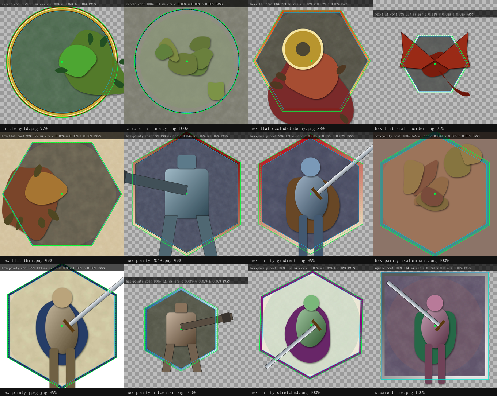

# Token Border Auto-Fit

A Foundry VTT module that finds the **border painted into token art** (a hexagon, circle or
square, even a gradient, a hairline, or one half-covered by a sword or a wing) and sets the
token's texture **scale and anchor** so that the border sits exactly on the token's grid shape:
hex size 1/2/3…, pointy-top or flat-top, square grids and gridless scenes.



*Green: detected outer edge (dashed: centre line, blue: inner edge of the band). Magenta: ground truth.*

> **Status: 0.1.0, not yet run inside Foundry.** The detector, the apply maths and the hook
> logic are covered by automated tests (see [Development](#development)), and the Foundry
> integration was written against the v13/v14 API docs and open sources. It has not been
> exercised in a live Foundry world yet. The [CHANGELOG](CHANGELOG.md) has a manual test checklist.

## Installation

**Manifest URL** (Foundry → *Add-on Modules* → *Install Module* → paste into *Manifest URL*):

```
https://github.com/DIREG502/token-border-autofit/releases/latest/download/module.json
```

Manual install: download `module.zip` from the latest release and unzip it to
`Data/modules/token-border-autofit/`.

**Compatibility:** Foundry v12+, written for v13. v14 is supported through version-tolerant API
access (see *How it works*) and the debug overlay shows if anything renders differently.
No system dependency; Lancer and Pathfinder 2e specifics are handled (see *Systems*).

## Using it

| Where | What |
|---|---|
| **Automatic** | When a token is created or its image changes, the border is detected and applied if the confidence is high enough (setting *Automatic fitting*: Auto / Ask / Off). Resizing a fitted token (e.g. Lancer changing a mech's size) re-applies the stored fit without detecting again. |
| **Token Config → Appearance** | **Fit border to grid** (detect + apply) and **Adjust manually** (alignment window). Works for placed tokens and prototype tokens. Unsaved image/size changes in the form are saved first. |
| **Token HUD** | Crosshair button: click to fit, right-click to align manually (toggle in settings). |
| **Batch** | Keybinding *Fit border of selected tokens* (unbound by default), or the macro `game.modules.get("token-border-autofit").api.fitSelected()`. Low-confidence tokens open the alignment window. |
| **Stand-alone macro** | For players who can't install modules: paste [`dist/token-border-autofit-macro.js`](dist/token-border-autofit-macro.js) into a *Script* macro. It contains the same detector, applies confident results to the selected tokens and opens the alignment dialog for the rest. Hold **Shift** while running it to always get the dialog. No hooks, settings or flags. |

Only tokens you are allowed to update are touched. Detection never applies anything silently
below the confidence threshold. It offers the alignment window instead.

### Manual alignment window

The token image with the detected border drawn on top, pre-filled with the auto-detect result.
The token on the canvas previews every change live.

- **Drag** inside the shape to move it, **drag a corner** to resize (Shift: free proportions,
  Alt: resize from the centre), **drag an edge handle** to resize one axis.
- **Arrow keys** nudge 1 px, **Shift+arrows** 10 px, **Ctrl+arrows** change width/height,
  **+ / −** grow/shrink, **Ctrl+wheel** zooms (or use the zoom menu: fit / 100 / 200 / 400 %).
- **Make regular** restores the exact proportions of a regular hexagon/circle/square.
- **Apply**, **Reset** (back to the starting outline), **Re-run auto-detect**, **Cancel** (reverts the preview).

## Settings

| Setting | Default | Meaning |
|---|---|---|
| Automatic fitting | Auto | *Auto*: apply when confident. *Ask*: prompt with Apply / Adjust… *Off*: buttons only. |
| Confidence threshold | 0.6 | Below this, nothing is applied silently; you get the alignment window. |
| Border line to align | Outer edge | Which line of the painted band goes on the grid shape: outer edge, centre or inner edge. |
| Proportions | Stretch | *Stretch*: match the shape's bounding box exactly (w and h separately, as specified). *Keep proportions*: uniform scale, fit inside. *Auto*: stretch only if the difference is ≤ 8 %. |
| Dynamic Token Ring | Skip and warn | Tokens using the core dynamic ring are left alone unless set to *Fit anyway*. |
| PF2e: turn off token autoscale | On | Only shown in PF2e worlds (see *Systems*). |
| Fit prototype tokens | On | Also detect when an actor's prototype token image changes. |
| Try other border shapes | On | If the grid's expected shape isn't found, also try circle / square / the other hex. |
| Rotation tolerance | 3° | How far a painted border may be rotated and still be found. |
| Expected border on gridless / square scenes | Circle / Auto | *Auto* on square grids = circle for ellipse-shaped tokens, otherwise square. |
| Debug overlay *(client)* | Off | Draws target box (cyan), predicted border (magenta) and rendered border (green). |
| Token HUD button *(client)* | On | |
| Cache detections *(client)* | On | Per-image results in `localStorage`; the same image is fitted instantly next time. *Clear cache* button in the settings. |
| Detection resolution *(client)* | 2048 px | Bigger images are scaled down to this before detection. |
| Notify when a fit is applied *(client)* | On | |

## How it works

### How Foundry draws a token texture (research notes)

From `Token#_refreshMesh` and `PrimarySpriteMesh#resize` (v12/v13: API docs, open-source
modules that override these methods, PF2e's `types/foundry` for v13 and v14):

```
mesh.resize(getSize().width, getSize().height, { fit, scaleX, scaleY })
     base scale from fit:  fill → (W/w, H/h) · contain → min · cover → max · width / height
     then multiplied by scaleX / scaleY ("the scale is applied after fitting")
mesh.anchor.set(anchorX, anchorY)      // normalised texture point placed at mesh.position
mesh.position = token centre point     // TokenDocument#getCenterPoint; rotation pivots here
```

So a texture pixel `(u, v)` lands at
`P + R(θ)·((u − anchorX·texW)·fx·scaleX, (v − anchorY·texH)·fy·scaleY)`. The module solves
this for `scaleX/Y` and `anchorX/Y` ([`src/core/fit-math.js`](src/core/fit-math.js)):
the border's centre goes to the centre of the token shape's bounding box, and its size to the
box's size. The sign of the existing scale (mirroring) is kept, and rotation plus an
off-centre pivot (even-size hex shapes) are taken into account. `texture.offsetX/Y` exist in
`TextureData` but tokens don't use them, so anchors are the right tool.

The target comes from the API, not from hand-written hex formulas: `TokenDocument#getSize`,
`#getCenterPoint` and `#getGridSpacePolygon` (v13+), falling back to `Token#getSize/#getShape`
(v12). Orientation comes from `grid.columns` and the token's `shape`. When the token is on the
canvas, the base scale is **measured from the live mesh** (`mesh.scale / texture.scale`)
instead of recomputed, so it keeps working if v14 or another module sizes the mesh differently.
The debug overlay compares the predicted outline with the one actually rendered and warns in
the console if they disagree.

### Detection ([`src/detector/`](src/detector/), pure JS, browser and Node)

1. **Features**: downscale to 512 px (area average) on alpha-**premultiplied** colour, so
   garbage colour under transparent pixels never creates edges. Edges come from a multi-channel
   structure tensor over luminance, two opponent-chroma channels (catches borders that only
   differ in hue) and alpha.
2. **Candidates**: a hexagon of known orientation is three pairs of parallel lines. Projecting
   edge pixels whose normal matches each side direction onto that normal gives 1-D histograms
   where each side is a peak, however much of it is hidden. Peak pairs fix scale and one centre
   coordinate, and a 1-D search finds the rest. Circles use gradient Hough voting plus a radial
   histogram.
3. **Robust score**: N points along the outline, edge energy along the normal, and the
   **fraction** of points that look like an edge (not the mean, so 30–40 % occlusion only costs
   30–40 %). Added to that: colour consistency on the opaque side of the edge, side balance, and
   a **band ("thin line") cue**: a painted border shows both its outer and inner edge, an art
   silhouette only one.
4. **Refinement** at full resolution: short profiles across the outline, robust (Tukey)
   Gauss-Newton on the signed distance, shrinking search radius. Each candidate is fitted
   twice, as a *regular* shape and with aspect/rotation free. The free fit must win clearly,
   because when art hides one or two sides it can drift to a slightly stretched hex that scores
   the same.
5. **Outer edge and thickness**: a scan of parallel edges inside and outside the fit. The
   thickness is the inner offset that forms a band with the outer edge on the most points.
6. **Confidence** 0–1 from coverage, inliers, band cue, colour consistency, side balance and the
   margin over the best competing (non-concentric) candidate. If the expected shape scores below
   0.8, the other shapes are scored too (fully refined only if their coarse evidence rivals the
   expected one). Another shape has to beat the expected one by a margin, and a result lying
   inside a clearly larger plausible one (a round shield inside a hex frame) loses to it: the
   border encloses the art.

**Benchmark** (`npm run bench`): the projection-histogram method against a brute-force grid
search with the same scoring and refinement:

| Method | Within 1.5 % | Mean time | Worst |
|---|---|---|---|
| Projection histograms (default) | 12 / 12 | ~130 ms | ~190 ms |
| Brute-force grid (`method: "grid"`) | 7 / 12 | ~7.8 s | ~24 s |

In Chrome (`dev/harness.html`) the slowest image takes 280 ms (its confidence is 0.75, so the
other shapes are tried too) and the 2048×2048 sample takes 197 ms. Accuracy on the test set:
centre and size errors 0.0–0.1 % of the border width. With a deliberately wrong shape hint
(`npm run test:detect -- --blind`, everything hinted as a pointy hex) all 12 are still found
through the fallback, at up to ~550 ms.

### Systems

- **Lancer**: the system only sets `width`/`height` from the mech's size (on creation and on
  frame changes) and an ellipse shape on gridless scenes. The module re-applies the stored fit
  on any size change, so the two cooperate.
- **Pathfinder 2e**: while `flags.pf2e.autoscale` is on, PF2e rewrites `texture.scaleX/Y`
  during data preparation. Fitting a token sets `autoscale: false` for it, the same thing PF2e's
  own Token Config does when you change the scale (setting, on by default).
- **TokenConfig re-saves**: the core Token Config has a single *scale* control, so re-saving a
  token with a non-uniform fit (scaleX ≠ scaleY) would flatten it. The module notices when the
  sheet just re-submits the old value and keeps the fitted pair.

### Stored data

`flags.token-border-autofit.fit = { src, shape, cx, cy, w, h, rotation, thickness, confidence,
imgW, imgH, detectorVersion, manual, applied }`: the border in source-image pixels. When
`texture.src` changes, the image is detected again. When `width/height/shape/fit` change, the
scale is recomputed from the flag.

## API

```js
const api = game.modules.get("token-border-autofit").api;
await api.fitSelected();                       // batch (low confidence → alignment window)
await api.fitSelected({ force: true });        // apply whatever the confidence
await api.fitToken(token, { mode: "ask" });    // "auto" | "ask" | "force"
await api.openAligner(token);                  // manual window
await api.detect("tokens/knight.webp", { shape: "hex-pointy" }); // detection only
await api.reapply(token);                      // re-apply the stored fit (after changing settings)
api.detectBorder(imageData, { shape: "circle" });  // the pure detector
```

## Extras beyond the original spec

Everything here can be switched off or is invisible by default:

| Extra | Why | Toggle |
|---|---|---|
| Two-hypothesis refinement (regular vs free) | Fixes drift to stretched hexes when art hides whole sides | always on (detector) |
| Band ("thin line") cue and thickness | Separates borders from art silhouettes; enables centre/inner reference lines | always on |
| *Border line to align* (outer / centre / inner) | Artists draw frames differently; the outer edge is the usual intent | setting |
| *Proportions*: Keep / Auto | Size 2/3 hex tokens have a bounding box that isn't hex-shaped; stretching a regular hex into it distorts the art | setting (default *Stretch*, as specified) |
| Live mesh base-scale measurement + debug comparison | Robust to v14 / other modules changing mesh sizing | automatic; overlay is a setting |
| Protection against Token Config flattening non-uniform scale | Otherwise any re-save of the sheet would undo the fit | automatic |
| Token HUD button, keybindings | Quicker than the config sheet | HUD setting; keybindings unbound |
| "Make regular", zoom, edge handles in the alignment window | Precise manual work on large images | – |
| Detection queue | A scene import with many tokens doesn't freeze the UI | – |
| Video tokens (first frame) | Animated `.webm` tokens with painted frames | – |

## Development

```
npm install
npm run gen:samples   # regenerate synthetic samples + ground truth in test-images/
npm run test:detect   # detect on every image in test-images/ → test-output/*.png + contact sheet
npm run test:unit     # apply maths + Foundry-mock integration tests
npm run bench         # projection vs grid method, per-stage timings
npm run build:macro   # dist/token-border-autofit-macro.js
npm run verify        # all of the above checks (package, tests, detection, macro build)
npm run harness       # serve dev/harness.html (?raw=1) to time the detector in a browser
```

**Test images**: `test-images/expected.json` holds the ground truth per file:
`{ shape, cx, cy, width, height, rotation, thickness }` for the **outer** edge, in source-image
pixels. The synthetic samples are generated with exact values. To add real token art, drop the
file into `test-images/`, run `npm run test:detect`, and copy the detected values from
`test-output/results.json` into `expected.json`, correcting them as needed. Files without an
entry are still detected and drawn, just not scored.

Layout: `src/detector/` (pure core, no Foundry), `src/core/fit-math.js` (pure apply maths),
`src/ui/` (plain-DOM alignment editor and prompt), `src/foundry/` (hooks, settings, UI
integration), `src/macro/` (stand-alone macro entry).

## License

MIT
